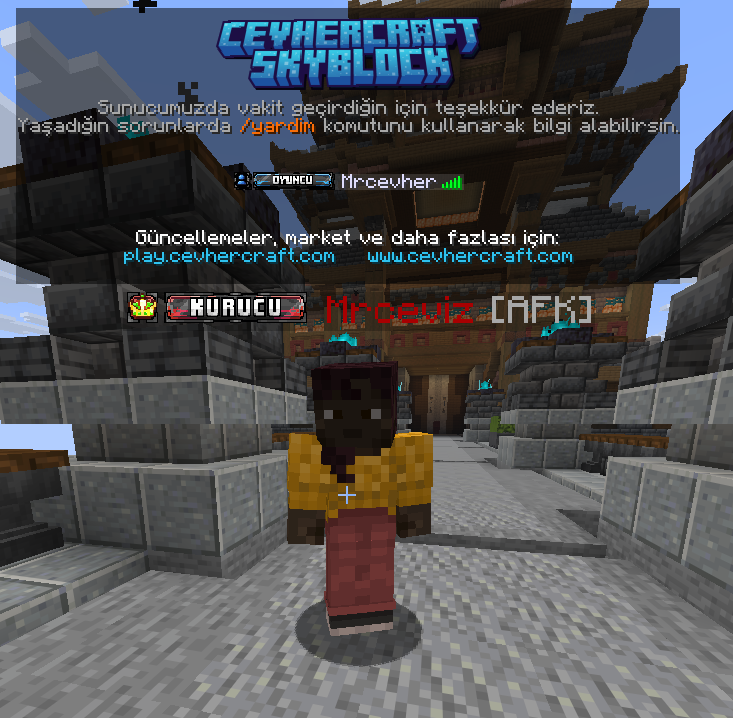

<p align="center">
  
</p>

<h1 align="center">CevherAfkTab</h1>

<p align="center">
  AFK olan oyuncuları <b>tab listesinden gizleyen</b>, dünyada görünür bırakan hafif bir Paper eklentisi.<br>
  <i>Hides AFK players from the tab list while keeping them visible in the world.</i>
</p>

---

## Ne işe yarar?

Büyük sunucularda tab listesi, uzun süredir başında olmayan (AFK) oyuncularla dolar. Bu eklenti,
**EssentialsX'te AFK durumuna geçen oyuncuyu diğer oyuncuların tab listesinden kaldırır**,
oyuncu AFK'dan dönünce de otomatik olarak geri ekler.

Bu bir *vanish* değildir: oyuncu dünyada normal görünür ve isim etiketini (ör. `[AFK]`) taşımaya
devam eder. Yalnızca **tab listesindeki satırı** gizlenir.

## Örnek görüntü



Görüntüde iki oyuncu var:

| Oyuncu | Durum | Tab listesinde | Dünyada |
|--------|-------|----------------|---------|
| **Mrcevher** | Aktif | ✅ Görünüyor | ✅ Görünüyor |
| **Mrceviz** | AFK | ❌ **Görünmüyor** | ✅ Karakter ve `[AFK]` etiketi görünüyor |

Ekranın üstündeki tab listesinde yalnızca aktif oyuncu (**Mrcevher**) listelenir. AFK olan **Mrceviz** ise
listede yer almaz; ama alttaki sahnede karakterinin başında `KURUCU` rütbesi ve `[AFK]` etiketiyle
hâlâ görülebilir.

## Nasıl çalışır?

1. EssentialsX bir oyuncunun AFK durumunu değiştirdiğinde `AfkStatusChangeEvent` olayını tetikler.
2. Eklenti bu olayı dinler:
   - **AFK'ya geçti** → oyuncu, sunucudaki diğer herkesin tab listesinden çıkarılır
     (Paper'ın `Player#unlistPlayer` metodu).
   - **AFK'dan döndü** → oyuncu, herkesin tab listesine geri eklenir (`Player#listPlayer`).
3. Sunucuya **sonradan giren** oyuncular için, o anda AFK olanlar giriş yaptıktan 1 saniye sonra
   onların listesinden de gizlenir.
4. Eklenti kapatılırken gizlenen herkes tab listesine geri eklenir, böylece kimse listeden
   kalıcı olarak kaybolmaz.

Oyuncunun kendi tab listesindeki satırı etkilenmez.

## Özellikler

- AFK durumuna göre **otomatik** gizleme ve geri gösterme
- Oyuncu dünyada görünür kalır (vanish değildir)
- Sonradan giren oyuncular için de çalışır
- Yetkililer için görme izni (`cevherafktab.gor`)
- Ayar dosyası gerektirmez, kurup çalıştırın
- Tek sınıf, tek bağımlılık: EssentialsX

## Gereksinimler

- **Paper 1.21+** (Java 21). `unlistPlayer` Paper API'sine ait olduğundan Spigot'ta çalışmaz.
- **EssentialsX** (AFK durumunu o sağlar)

## Kurulum

1. [Releases](../../releases) bölümünden son `CevherAfkTab-x.y.z.jar` dosyasını indirin
   (ya da aşağıdaki gibi kendiniz derleyin).
2. Jar'ı sunucunuzun `plugins` klasörüne koyun.
3. Sunucuyu yeniden başlatın.

## Yetkiler

| Yetki | Açıklama | Varsayılan |
|-------|----------|-----------|
| `cevherafktab.gor` | AFK oyuncuları tab listesinde görmeye devam eder (yetkililer için kullanışlıdır) | Kimse |

## TAB eklentisi ile kullanım

Eklenti, [TAB](https://github.com/NEZNAMY/TAB) kullanan bir sunucuda geliştirilmiştir. TAB'da AFK
etiketi için `%essentials_afk%` kullanıyorsanız ve PlaceholderAPI'nin `boolean` değerleri
`✔`/`✖` ise, bu simgeler isminizin yanında görünür. `placeholder-output-replacements` ile
çıktıları temizleyin:

```yaml
placeholder-output-replacements:
  '%essentials_afk%':
    'yes': ' &7[AFK]'
    'no': ''
    '&a✔': ' &7[AFK]'
    '&c✖': ''
```

## Derleme

Paper API (1.21) ve EssentialsX jar'larını sınıf yoluna ekleyerek derleyin:

```bash
javac --release 21 -encoding UTF-8 -cp "paper-api.jar;EssentialsX.jar" \
  -d build/classes $(find src/main/java -name '*.java')
cp -r src/main/resources/. build/classes/
jar cf CevherAfkTab-1.0.0.jar -C build/classes .
```

## Sık sorulanlar

**Oyuncu AFK iken dünyada görünmez mi olur?**
Hayır. Yalnızca tab listesinden gizlenir.

**Kendi tab listemde kendimi görür müyüm?**
Evet, oyuncunun kendi satırı değiştirilmez.

**Yetkililer AFK oyuncuları görebilir mi?**
`cevherafktab.gor` yetkisini vererek.

## Lisans

[MIT](LICENSE) © 2026 CevherCraft
